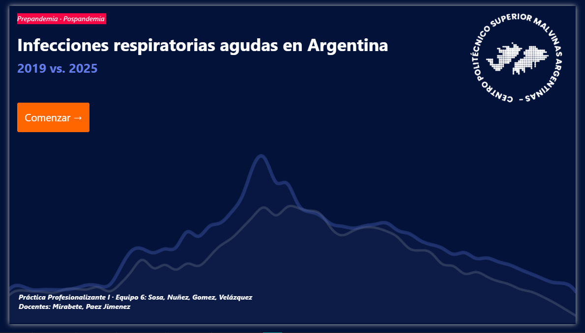
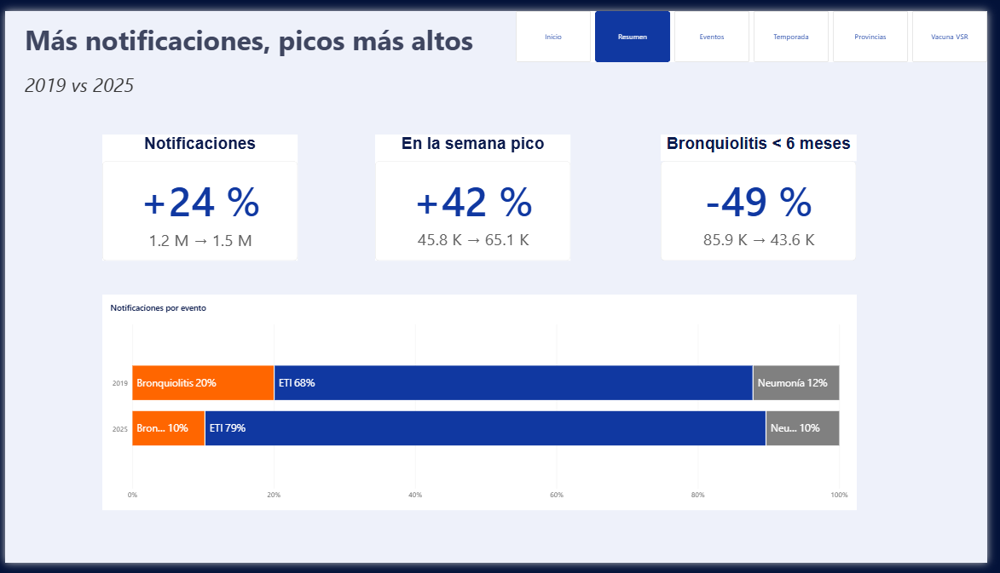
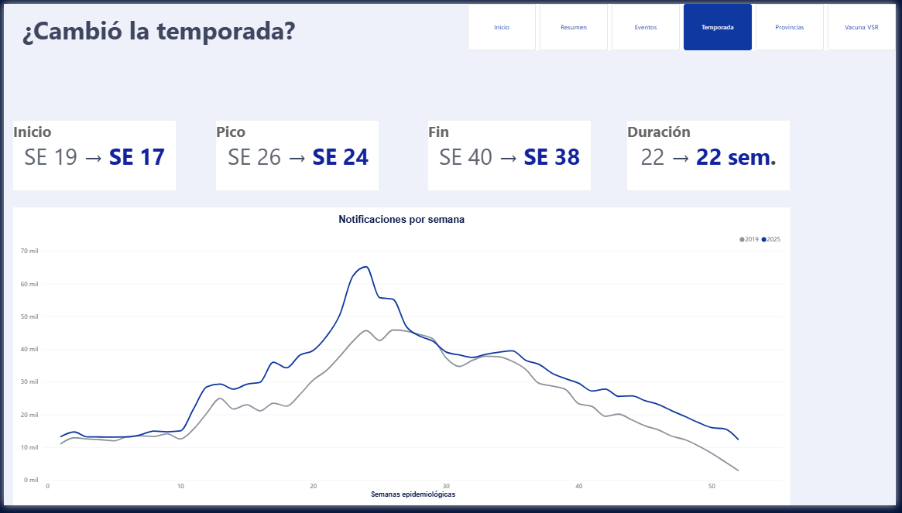

# Infecciones respiratorias agudas en Argentina: 2019 vs. 2025

Proyecto final de **Práctica Profesionalizante I** · Tecnicatura Superior en Ciencia de Datos e Inteligencia Artificial
Centro Politécnico Superior Malvinas Argentinas · 2026

> **¿Volvieron a ser como antes?** Comparamos las infecciones respiratorias de un año completo antes de la pandemia (2019) con uno después (2025), usando datos abiertos del Ministerio de Salud.

🎬 **Video de divulgación:** [YouTube](https://drive.google.com/drive/folders/1bWwa-w-8TzvDQ17WDh_xo1EledEcrMMR) · 📊 **Tablero Power BI:** `Analysis/proyecto_Salud_base_v4.pbix` · 📁 **Carpeta del proyecto:** [Google Drive](https://drive.google.com/drive/folders/1Tc912myRUPyoWo59Rd5zTME79dbHlJdT)

## Integrantes del equipo

**Equipo 6**

- Maria Silvana Sosa
- Pablo Nuñez
- Estela Gomez
- Pablo Velázquez

Docentes: Martin Maximiliano Mirabete y Silvana Paez Jimenez

---

## Descripción del proyecto

Las infecciones respiratorias agudas (IRA) se vigilan semana a semana en el Sistema Nacional de Vigilancia de la Salud (SNVS), que registra tres tipos de cuadros: **enfermedad tipo influenza (ETI)**, **neumonía** y **bronquiolitis** en menores de 2 años. Entre 2020 y 2022 la pandemia de COVID-19 alteró la circulación de los virus respiratorios, la forma de consultar y los sistemas de vigilancia.

Este proyecto describe **qué cambió entre 2019 (prepandemia) y 2025 (pospandemia)**: qué eventos y edades concentran los cambios, en qué semanas empieza y termina la temporada, y qué provincias tienen más notificaciones por habitante.

El análisis es **descriptivo**: muestra lo que cambió, pero no atribuye causas. Cuando se usa contexto externo, se presenta como coincidencia.

---

## Fuente de datos

| Dataset | Fuente | Registros | Uso |
|---|---|---|---|
| Vigilancia de IRA 2018-2019 | Ministerio de Salud – SNVS ([datos.salud.gob.ar](https://datos.salud.gob.ar/dataset/vigilancia-de-infecciones-respiratorias-agudas)) | 790.773 | Línea de base prepandemia (2019) |
| Vigilancia de IRA 2025-2026 | Ministerio de Salud – SNVS 2.0 ([datos.salud.gob.ar](https://datos.salud.gob.ar/dataset/vigilancia-de-infecciones-respiratorias-agudas)) | 422.868 | Etapa pospandemia (2025) |
| Población por jurisdicción | INDEC – Censo 2022 | 25 | Tasas cada 100.000 habitantes |
| Coberturas del Calendario Nacional 2024 | Ministerio de Salud (informe PDF, tablas extraídas a CSV) | 764 | Cobertura de la vacuna VSR en gestantes |
| Vacunas COVID-19 por jurisdicción | Ministerio de Salud | 358 | Explorado y descartado (sin relación con la incidencia, r = 0,19) |

- **Tipo de datos:** salud pública – vigilancia epidemiológica. Datos agregados y anonimizados.
- **Unidad de análisis:** notificaciones por provincia, semana epidemiológica, evento y grupo de edad.
- **Período comparado:** 2019 y 2025, semanas epidemiológicas 1 a 52. Se excluyen 2018 (empieza en la SE 18), 2026 (incompleto) y la SE 53 de 2025.
- Una **notificación** es un caso registrado en el sistema, no el total real de personas enfermas.
- El detalle de cada variable está en el **diccionario de datos** (`docs/`).

---

## Objetivos del análisis

**Objetivo general:** describir cómo cambiaron las infecciones respiratorias agudas en Argentina entre 2019 y 2025.

**Preguntas de análisis:**

1. **¿Qué cambió?** ¿Qué eventos y grupos de edad aumentaron y cuáles disminuyeron?
2. **¿Cuándo?** ¿En qué semanas empieza, alcanza su pico y termina la temporada en cada año?
3. **¿Dónde?** ¿Qué provincias tienen más notificaciones por habitante y cómo cambió?

Como contexto de la pregunta 1 se analizó la **bronquiolitis por edad** junto con la cobertura de la **vacuna contra el virus sincicial respiratorio (VSR)** en gestantes, incorporada al Calendario Nacional en 2024.

---

## Herramientas utilizadas

- **Power BI Desktop:** modelo de datos, medidas DAX y tablero interactivo
- **OpenRefine:** limpieza y normalización; API Georef para los códigos de provincia
- **Python** (pandas, matplotlib): análisis exploratorio y validación de totales
- **Excel / CSV**
- **GitHub, Google Drive, Trello y Google Meet:** control de versiones, documentación y organización del equipo

---

## Proceso de análisis

**Sprint 1 – Comprensión del problema y de los datos**
Ficha de dominio, diccionario de datos, análisis exploratorio (EDA) inicial y selección de 3 preguntas de análisis entre 10 formuladas.

**Sprint 2 – Preparación de datos (ETL), análisis y tablero**
- **Limpieza:** corrección de tildes y nombres de provincias, unificación de columnas (`anio` → `año`), suma de filas repetidas en 2018-2019 y conversión de la población de texto a número.
- **Transformaciones:** agrupación de eventos (ETI, Neumonía, Bronquiolitis) y de los 13 grupos de edad en 6; extracción de las coberturas de vacunación desde el PDF del Ministerio.
- **Integración:** anexado de 2018-2019 y 2025-2026 en la tabla `Casos` y modelo estrella con `DimProvincia` (código INDEC) relacionada con Casos, Población y Coberturas.
- **Medidas DAX:** variación %, semana pico, inicio y fin de la temporada, incidencia cada 100.000 habitantes y cobertura VSR.
- Cada paso está registrado en la **bitácora ETL** (47 entradas) y en el **registro de errores**.

**Sprint 3 – Cierre y comunicación**
Selección de 4 insights, informe técnico final, manual de usuario del tablero, presentación técnica (10 filminas) y presentación de divulgación con video para YouTube.

---

## Resultados principales

- **Más notificaciones, pero no en todos los cuadros:** subieron un **24 %** (1.266.350 → 1.572.497). La ETI creció un **46 %**, la neumonía casi no cambió (**+6 %**) y la bronquiolitis bajó un **37 %**.
- **Cambió quién aparece en los registros:** la ETI aumentó en todas las edades, sobre todo entre los 45 y 64 años (+73 %). Los menores de 2 años pasaron del 31 % al 19 % de las notificaciones.
- **El invierno llegó antes:** la temporada duró lo mismo (22 semanas), pero en 2025 empezó, alcanzó su pico y terminó **2 semanas antes**, y la peor semana tuvo un **42 % más** de notificaciones (45.850 → 65.184).
- **El mapa no se movió:** por habitante, **Catamarca, La Rioja, Jujuy y Chaco** encabezan los dos años. Catamarca registra casi 4 veces el promedio del país.
- **La bronquiolitis baja más cuanto menor es la edad:** −49 % en menores de 6 meses, −39 % de 6 a 11 meses y −29 % de 12 a 23 meses. Coincide con la vacuna VSR en gestantes (cobertura 2024: 67,8 %); los datos muestran la coincidencia, no la causa.

---

## Visualizaciones

El tablero tiene 6 páginas, con navegación y el tema visual del Politécnico.

| Página | Responde |
|---|---|
| Inicio | Portada del proyecto |
| Resumen | Los tres cambios principales |
| Eventos | ¿Qué eventos y edades cambiaron? |
| Temporada | ¿Cambió la temporada? |
| Provincias | ¿Dónde hay más notificaciones por habitante? |
| Vacuna VSR | Bronquiolitis por edad y cobertura de la vacuna |


### Página de inicio


### Resumen


### Eventos


### Temporada


### Provincias


### Vacuna VSR


> **Nota:** los mapas usan Azure Maps y se muestran solo si se inicia sesión en Power BI Desktop con una cuenta laboral o educativa. En la carpeta `docs/capturas/` y en el PDF del tablero se pueden ver sin iniciar sesión.

---

## Conclusiones

- **Qué se descubrió:** después de la pandemia, las infecciones respiratorias no volvieron a ser como antes. Hay más notificaciones, la temporada llega antes y con un pico más alto, y el peso se movió de los bebés a los escolares y adultos. Lo que no cambió es el mapa: las provincias con mayor incidencia son las mismas.
- **Valor del análisis:** comparar semana por semana, por edad y por habitante muestra cambios que el total anual esconde.
- **Contexto (coincidencias, no causas):** el Boletín Epidemiológico Nacional N° 763 (2025) informa un adelanto de la influenza A (H1N1) desde la semana 11, y el N° 831 (2026), un marcado descenso de la bronquiolitis desde 2024.
- **Limitaciones:** las notificaciones no equivalen a casos reales; Santa Fe y CABA presentan subnotificación; los datos no indican qué virus causó cada caso; se usa la población del Censo 2022 para ambos años.
- **Líneas futuras:** incorporar los años 2020-2024 y 2026 completo, cruzar con la vigilancia de laboratorio (virus por semana) y sumar la cobertura VSR de la campaña 2025. ¿Fue 2025 un año raro, o es el nuevo calendario?

---

## Archivos del proyecto

```
Analysis/
  proyecto_Salud_base_v4.pbix          → tablero Power BI
  Tema_Politecnico_Malvinas.json       → tema visual del tablero
data/
  raw/                                 → datos originales
  processed/                           → datos limpios y coberturas de vacunación (CSV)
docs/
  capturas/                            → imágenes de las páginas del tablero
  diccionario de datos, ficha de dominio, bitácora ETL, registro de errores
reports/
  Sprint 1                             → EDA inicial, informe técnico, preguntas de análisis
  Sprint 2                             → reporte de insights, check de limpieza, documento de cierre
  Sprint 3                             → informe técnico final, insights consolidados, manual de usuario,
                                         presentaciones, guion del video, retrospectiva
README.md
```

---

## Contacto

Equipo 6 · Práctica Profesionalizante I · Centro Politécnico Superior Malvinas Argentinas
